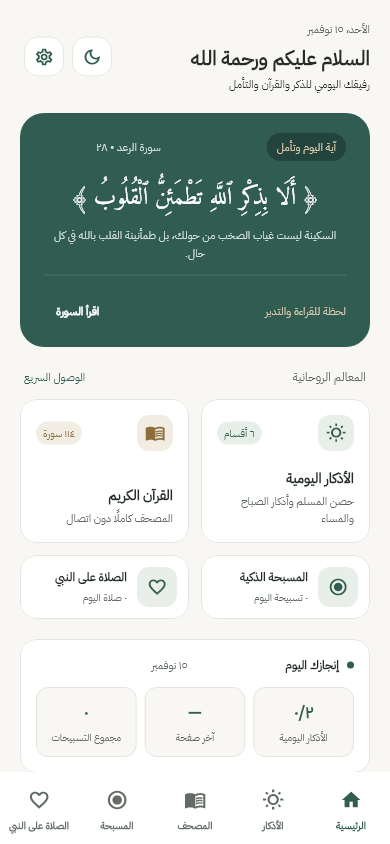
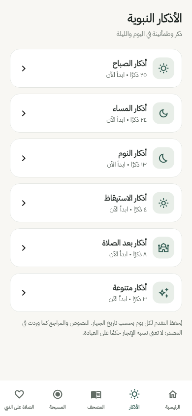
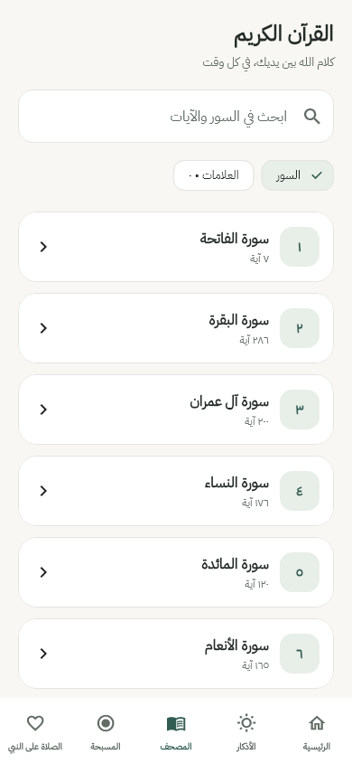
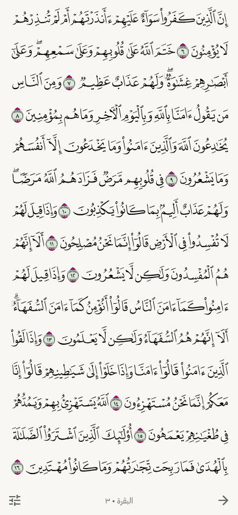
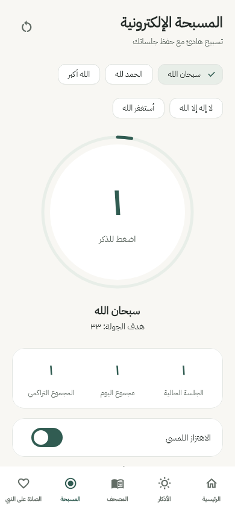
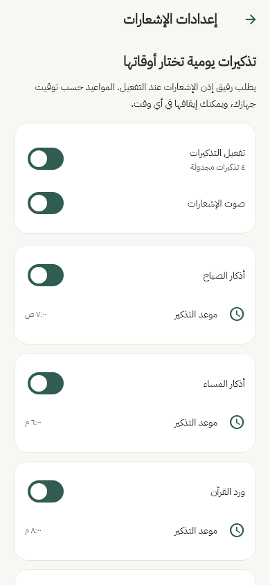
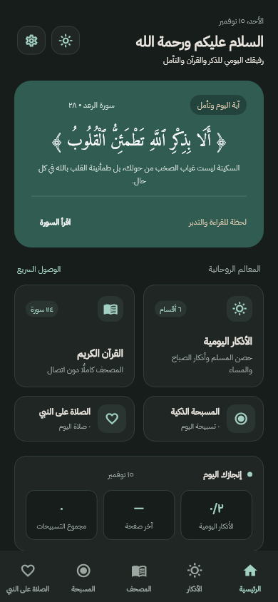
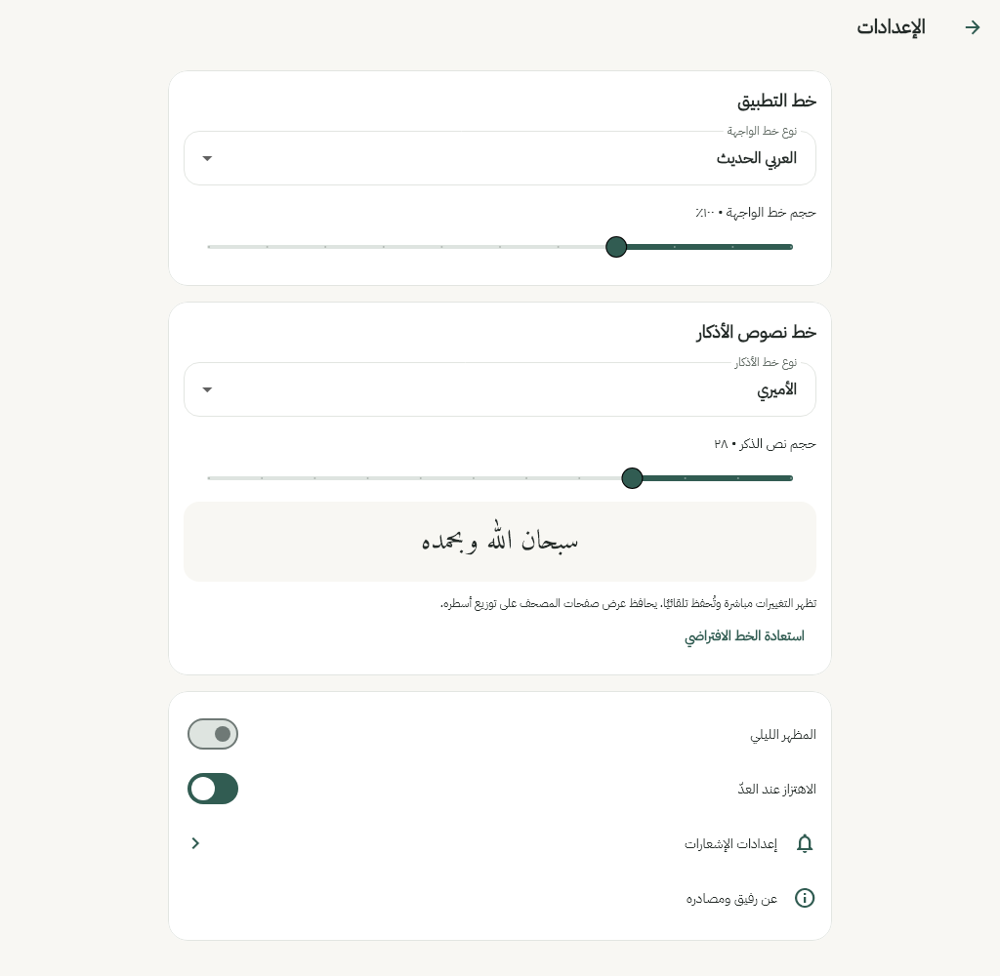

<div align="center">

# رَفِيق | Rafeeq

**رفيقك اليومي للذكر والقرآن — أساس مفتوح المصدر لبناء تطبيقات دينية بـ Flutter**

[](https://github.com/EnadAbulawi/rafeeq/actions/workflows/checks.yml)
[](LICENSE)
[](https://flutter.dev)

</div>

<div dir="rtl">

> **هذا التطبيق صدقة جارية عن روح والدي، رحمه الله وغفر له وأسكنه فسيح جناته.**
>
> أشارك المشروع لكل من يريد إنشاء تطبيق ديني جاهز كأساس، دون أن يبدأ من الصفر.
> نسأل الله أن ينفع به، وأن يجعل الخير الناتج عنه في ميزان حسناته وحسنات كل من ساهم فيه.

رفيق تطبيق عربي للقرآن والأذكار والمسبحة والتذكيرات، بواجهة هادئة ومظهر نهاري وليلي.
يمكنك استخدام الشفرة وتطويرها مع حفظ حقوق التطوير ومصادر المحتوى.
لا يحتاج حسابًا أو خادمًا؛ القراءة والعدادات والتذكيرات محلية، والتلاوة عبر الإنترنت.

**التطوير:** [عناد أبولاوي — Enad Abulawi](https://github.com/EnadAbulawi).

## المميزات

- **المصحف:** ٦٠٤ صفحات بخطوط QCF وتوزيع أسطر ثابت، مع عرض عمودي بديل.
- **القرآن كاملًا:** ١١٤ سورة و٦٢٣٦ آية من نص تنزيل العثماني، مع البحث والعلامات وحفظ موضع القراءة.
- **التلاوة:** العفاسي والحصري وعبد الباسط عبر EveryAyah، مع الإيقاف المؤقت والتكرار ومتابعة آيات السورة.
- **الأذكار:** ستة أقسام و٧٧ نصًا بعد تهيئة البيانات، مع التكرار والتقدم اليومي والمراجع وفضل ٢٦ ذكرًا كما ورد في مصدرها.
- **المسبحة والصلاة على النبي:** جلسات مستقلة ومجاميع يومية وتراكمية وهدف اختياري محفوظ.
- **التذكيرات المحلية:** مواعيد قابلة للتعديل، إذن صريح للإشعارات، تحكم بالصوت وإشعار تجريبي.
- **الخط والواجهة:** اختيار الخط وحجم الواجهة ونصوص الأذكار، ودعم العربية وRTL والمظهر الليلي والمقاسات الضيقة والتابلت.
- **الحفظ:** SQLite للإعدادات والعدادات والعلامات، دون حساب أو خدمة سحابية مطلوبة.

## صور التطبيق

الصور من الشفرة الحالية أثناء اختبارات العرض، ببيانات تجريبية وليست بيانات شخصية من هاتف.

<table>
<tr>
<td align="center"><br />الرئيسية</td>
<td align="center"><br />الأذكار</td>
<td align="center"><br />فهرس السور</td>
</tr>
<tr>
<td align="center"><br />المصحف</td>
<td align="center"><br />المسبحة</td>
<td align="center"><br />التذكيرات</td>
</tr>
</table>

<details>
<summary>المظهر الليلي والإعدادات على التابلت</summary>




</details>

## التشغيل

المتطلبات: Flutter **3.47.2** مع Dart **3.13.2**، وPython **3.10+**، وبيئة Android/JDK 17 المناسبة.
لا يحتاج سكربت التهيئة مكتبات Python إضافية.

</div>

```bash
git clone https://github.com/EnadAbulawi/rafeeq.git
cd rafeeq
python tool/prepare_content.py
flutter pub get
flutter run
```

<div dir="rtl">

على بعض الأنظمة يُستخدم `python3` بدل `python`. يتطلب تشغيل iPhone جهاز macOS وإعداد Xcode والتوقيع المناسب.

**تهيئة الأذكار مطلوبة مرة واحدة:** لم يظهر ترخيص واضح لإعادة توزيع مجموعتي بيانات الأذكار، لذلك لا يتضمن المستودع نسخهما أو الملف المدمج. يجلب السكربت نسخًا ثابتة من المصدرين ويتحقق من بصمة محتواهما ثم يجهّز البيانات محليًا. تبقى الملفات الناتجة خارج Git. تحميلها لا يمنح تلقائيًا حق إعادة توزيعها؛ راجع حقوقها أو استبدلها بمصدر مرخّص قبل نشر نسختك. التفاصيل في [إشعارات الطرف الثالث](THIRD_PARTY_NOTICES.md).

بعد التهيئة تعمل قراءة القرآن والأذكار والعدادات دون اتصال. التلاوة تُبث عبر الإنترنت؛ لا يتضمن المشروع تنزيلات صوتية أو خدمة تشغيل خلفية للتلاوة.

## ابنِ تطبيقك اعتمادًا على رفيق

1. أنشئ نسخة أو Fork واتبع خطوات التشغيل.
2. غيّر اسم التطبيق وهويته ومعرّف الحزمة `com.example.rafeeq` إلى معرّف تملكه.
3. خصّص الواجهة من `lib/core/theme/app_theme.dart` وراجع [قواعد التصميم](DESIGN.md).
4. أضف ميزاتك ضمن `lib/features/` مع الحفاظ على بيانات المستخدم ومعرّفات السورة والآية.
5. راجع تراخيص المحتوى والخطوط، واضبط توقيع الإنتاج؛ إعداد Android الحالي يستخدم توقيع Debug.
6. اختبر التذكيرات والصوت والأيقونة على أجهزتك قبل التوزيع.

الشفرة أساس قابل للتطوير، ولا تتضمن حساب متجر أو توقيع نشر أو اعتمادًا شرعيًا شاملًا للمحتوى.

## البنية

</div>

```text
lib/
  app/                  # Bootstrap, navigation and persisted state
  core/                 # Theme and SQLite storage
  features/
    adhkar/             # Categories, repetition and attributed virtues
    counters/           # Tasbih and salawat
    home/               # Dashboard
    quran/              # QCF, search and online recitation
    settings/           # Typography and local reminders
  shared/widgets/       # Reusable UI and source notices
assets/                 # Quran text and licensed UI fonts
tool/                   # Content preparation and verification
test/                   # Logic, content, loading, audio and UI tests
```

<div dir="rtl">

إدارة الحالة بـ ChangeNotifier، والحفظ عبر SQLite. تعرض `qcf_quran_plus` المصحف، وتُجلب التلاوات من [EveryAyah](https://everyayah.com) وتُشغّل عبر `just_audio`. التذكيرات من `flutter_local_notifications` وتعمل بإذن المستخدم؛ أوقاتها يحددها المستخدم وليست مواقيت صلاة محسوبة.

## التحقق والمساهمة

</div>

```bash
python tool/prepare_content.py
flutter analyze
flutter test --concurrency=1
python tool/verify_content.py
```

<div dir="rtl">

آخر تحقق محلي بتاريخ **١٧ نوفمبر ٢٠٢٦**: **٦٩ اختبارًا ناجحًا** وتحليل دون ملاحظات. تعمل GitHub Actions على فحص المصدر والاختبارات فقط؛ لا تُنشئ APK/AAB ولا تنشر إصدارًا تلقائيًا. راجع شارة GitHub لأحدث نتيجة، و[سجل التحقق](VALIDATION.md) لحدود الفحص.

مرحبًا بالإصلاحات والاقتراحات عبر Issues وPull Requests. راجع [دليل المساهمة](CONTRIBUTING.md)، وأرفق مصدرًا لأي تغيير في نص ديني أو فضل ذكر أو عدد تكرار.

## الترخيص وحفظ الحقوق

الشفرة الأصلية متاحة برخصة [MIT](LICENSE): يمكن استخدامها وتعديلها وتوزيعها مع الإبقاء على إشعار حقوق النشر ونص الرخصة وفق شروطها. **حقوق التطوير الأصلية محفوظة لعناد أبولاوي والمساهمين في رفيق.** وضع رابط المشروع في صفحة «حول التطبيق» محل تقدير، وليس قيدًا إضافيًا على الرخصة.

النص القرآني من [تنزيل](https://tanzil.net) وفق شروطه الخاصة؛ لا يُعدّل نصه ولا تُزال نسبته. الخطوط والمكتبات والتلاوات وبيانات الأذكار لها حقوق مستقلة، ولا تشملها رخصة MIT الخاصة بشفرتنا. راجع [NOTICE](NOTICE.md) و[إشعارات الطرف الثالث](THIRD_PARTY_NOTICES.md).

اللهم اغفر لوالدي وارحمه، واجزِ كل من ساهم في هذا العمل خير الجزاء.

</div>
